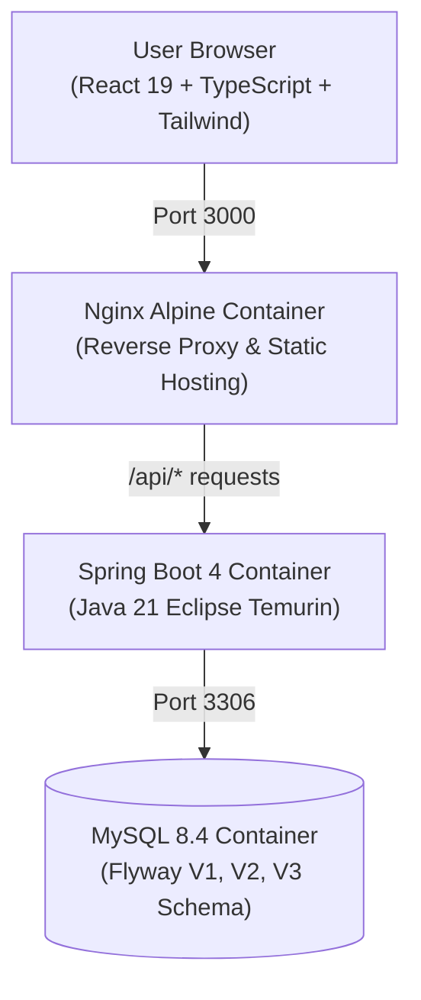

# 🏠 StayWise - PG Finder & Accommodation Management Platform

StayWise is a full-stack, enterprise-grade Paying Guest (PG) accommodation and hostel management platform tailored for students, working professionals, PG owners, and platform administrators across Bangalore tech hubs (BTM Layout, Koramangala, HSR Layout, Indiranagar, Marathahalli, Electronic City).

---

## 🚀 Quick Start (Single Docker Command)

The entire platform—**React Frontend**, **Spring Boot 4 Backend**, and **MySQL 8.4 Database**—is fully containerized and boots up with a single command:

```bash
docker compose up --build -d
```

### 🌐 Service URLs
| Service | URL | Description |
| :--- | :--- | :--- |
| **Frontend Web App** | [http://localhost:3000](http://localhost:3000) | Modern React 19 UI with Tailwind CSS |
| **Backend REST API** | [http://localhost:8080](http://localhost:8080) | Spring Boot 4 REST API & Actuator/Health |
| **Direct API Health Check** | [http://localhost:3000/api/health](http://localhost:3000/api/health) | Nginx Reverse Proxy Route |
| **MySQL Database** | `localhost:3307` | MySQL 8.4 database (`staywise`) |

---

## 🔑 Pre-Seeded Demo Accounts

The database is pre-seeded with realistic Bangalore PGs, room types, live bed availability, reviews, and test accounts. Quick 1-click login buttons are also embedded directly into the frontend Auth modal for instant role switching!

| Role | Email | Password | Pre-loaded Capabilities |
| :--- | :--- | :--- | :--- |
| **Admin** | `admin@staywise.com` | `password123` | Platform analytics, Approve/Reject PG listings |
| **PG Owner** | `owner.suresh@staywise.com` | `password123` | Manage 3 PGs, Add new listing, Accept/Reject booking requests |
| **Student / Tenant** | `student.sandesh@staywise.com` | `password123` | Search PGs, Filter by rent/sharing/gender, Book bed, Leave reviews, Wishlist |

---

## 🛠️ Tech Stack & Architecture



- **Frontend**: React 19, TypeScript, Tailwind CSS v4, Lucide Icons, Vite.
- **Backend**: Java 21, Spring Boot 4.1.1, Spring Data JPA (Hibernate 7), Spring Security 7.1.1, JJWT (HMAC-SHA384).
- **Database & Migrations**: MySQL 8.4 with Flyway automatic database versioning and seed data.
- **Containerization**: Docker & Docker Compose with multi-container bridge networking and persistent volumes.

---

## 🐞 Bug Fix & Root Cause Analysis

### The Initial Error
```
org.springframework.beans.factory.BeanCreationException: ...
Unable to obtain connection from database: Access denied for user 'staywise_app'@'172.17.0.1' (using password: YES)
SQL State : 28000
Error Code : 1045
```

### Root Cause
1. **Network Host Restrictions**: In Docker environments, connections traversing bridge networks reach MySQL from host/bridge gateway IPs such as `172.17.0.1` or the container internal IP, not `localhost`. The MySQL user `staywise_app` was initially restricted or missing wildcard host (`%`) permissions.
2. **Credential Mismatch**: Environment variables between `.env`, `application.properties`, and Docker entrypoint initialization scripts needed synchronized fallback defaults.

### Solution Applied
1. Granted remote wildcard privileges:
   ```sql
   CREATE USER IF NOT EXISTS 'staywise_app'@'%' IDENTIFIED BY 'staywise_password';
   GRANT ALL PRIVILEGES ON staywise.* TO 'staywise_app'@'%';
   FLUSH PRIVILEGES;
   ```
2. Added self-contained Docker Compose initialization script (`database/init/01-init.sql`) ensuring clean setup on any fresh machine without requiring external MySQL installations.
3. Configured Spring Boot database fallback chain: `${SPRING_DATASOURCE_PASSWORD:${STAYWISE_DB_PASSWORD:staywise_password}}`.

---

## 📱 Platform Features

1. **Local Bangalore Search & Filters**:
   - Filter by popular localities (BTM Layout, Koramangala, HSR Layout, Indiranagar, Marathahalli, Electronic City).
   - Filter by gender preference (Male, Female, Unisex), food type (Veg, Non-Veg, Both), and maximum rent slider.
   - Verified PG filter toggle.
2. **Detailed Property View**:
   - High-resolution photo galleries.
   - Available room sharing types (Single, Double, Triple) with live available bed counts.
   - Verified amenities with icons (Wi-Fi, 3x Meals, AC, Power Backup, Housekeeping, CCTV).
   - Live booking request modal with move-in date selection and notes.
   - Tenant rating & review breakdown.
3. **Student / Tenant Dashboard**:
   - Active bookings overview with real-time status badges (`CONFIRMED`, `PENDING`, `REJECTED`).
   - Wishlist management.
4. **PG Owner Dashboard**:
   - Comprehensive property portfolio management.
   - Interactive booking requests drawer: Accept or Reject incoming tenant applications.
   - "Add New PG" multi-step listing modal with Bangalore locality selector, amenity checklist, and initial room configuration.
5. **Admin Moderation Portal**:
   - Platform KPI summary metrics (Total users, verified PGs, pending approvals, total bookings).
   - PG Verification review queue: Approve or Reject submissions with custom feedback notes.

---

## 🛑 Teardown & Reset Commands

To stop all containers:
```bash
docker compose down
```

To stop and reset database data for a clean slate:
```bash
docker compose down -v
docker compose up --build -d
```
